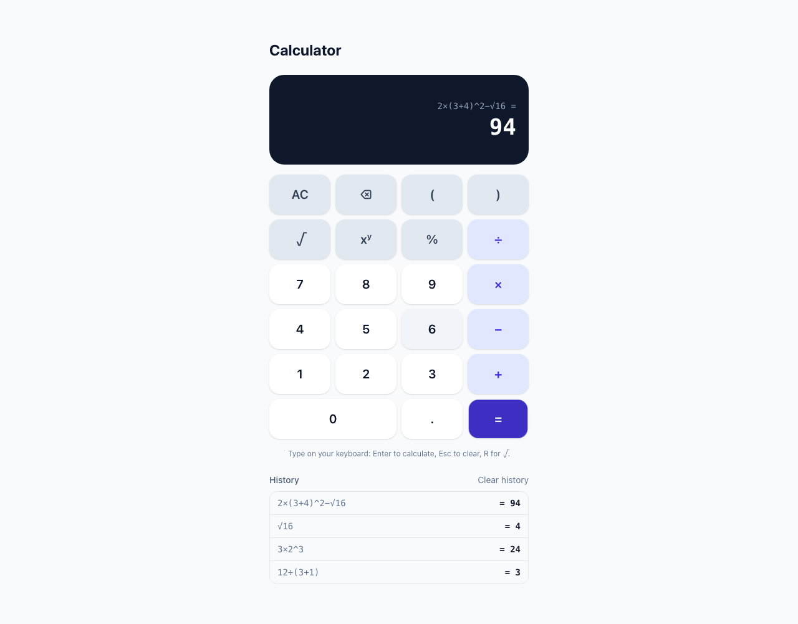
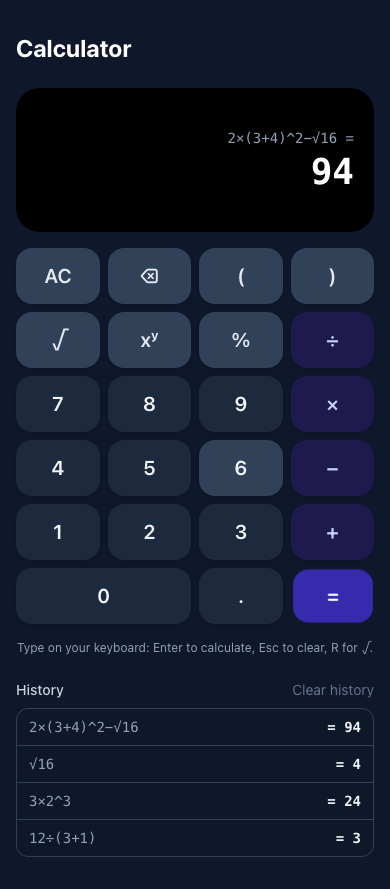

# Calculator

A full-stack calculator: a React + TypeScript keypad calculator that sends
each expression to a Go REST service to evaluate. The service owns parsing,
arithmetic and validation. The frontend owns input, display and feedback.

| Desktop (light)              | Mobile (dark)              |
| ---------------------------- | -------------------------- |
|  |  |

**Operations:** addition, subtraction, multiplication, division,
exponentiation, square root and percentage, combined freely with brackets,
for example `2×(3+4)^2−√16`.

**Input:** tap the on-screen keypad or type on the keyboard. Each physical
keystroke highlights its key on the keypad.

| Keyboard        | Keypad           |
| --------------- | ---------------- |
| `0`–`9`, `.`    | digits, `.`      |
| `+` `-` `*` `/` | `+` `−` `×` `÷`  |
| `^` `%` `(` `)` | `xʸ` `%` `(` `)` |
| `r`             | `√`              |
| `Enter` or `=`  | `=`              |
| `Backspace`     | `⌫`              |
| `Esc`           | `AC`             |

Pasting an expression works too.

## Contents

- [Quick start (Docker)](#quick-start-docker)
- [Local development](#local-development)
- [Tests and coverage](#tests-and-coverage)
- [API](#api)
- [Project structure](#project-structure)
- [Design decisions](#design-decisions)
- [Assumptions](#assumptions)
- [What I would do next](#what-i-would-do-next)
- [AI usage and prompts](#ai-usage-and-prompts)

## Quick start (Docker)

```sh
docker build -t calculator .
docker run --rm -p 8080:8080 calculator
```

Open http://localhost:8080. A single container serves both the built frontend
and the API, on the same origin.

## Local development

**Prerequisites:** Go 1.26+, Node.js 24+ (npm 11), and optionally
[golangci-lint](https://golangci-lint.run) v2 for `make lint`.

```sh
make install          # npm ci + go mod download
```

Run the two halves in separate terminals:

```sh
make dev-backend      # Go API on http://localhost:8080
make dev-frontend     # Vite dev server on http://localhost:5173
```

Open http://localhost:5173. Vite proxies `/api/*` to the backend, so the
browser only ever talks to one origin and no CORS setup is needed. If the
backend runs elsewhere, set `API_URL` for the frontend, for example
`API_URL=http://localhost:9000 npm run dev`.

Without `make`:

```sh
cd backend && go run ./cmd/server
cd frontend && npm ci && npm run dev
```

### Configuration

The backend reads environment variables:

| Variable     | Default | Purpose                                            |
| ------------ | ------- | -------------------------------------------------- |
| `PORT`       | `8080`  | Port to listen on.                                 |
| `STATIC_DIR` | unset   | Directory of built frontend files to serve at `/`. |

To run the production layout without Docker, use `make build`, then
`STATIC_DIR=frontend/dist ./dist/server`.

## Tests and coverage

```sh
make test       # Go tests (with -race) and Vitest
make coverage   # coverage summaries plus HTML reports
make lint       # go vet, golangci-lint, ESLint, Prettier, tsc
```

`make coverage` writes `coverage/backend.html` and
`frontend/coverage/index.html`. At the time of submission:

| Layer    | Tests                                                                                                                                                | Statement coverage                                    |
| -------- | ---------------------------------------------------------------------------------------------------------------------------------------------------- | ----------------------------------------------------- |
| Backend  | Go `testing`: table tests for every operation, the expression grammar, syntax errors and arithmetic edge cases, plus HTTP tests through the real mux | 93.9% (`-coverpkg=./...`); `calculator` package 97.9% |
| Frontend | Vitest + Testing Library: 100 tests covering keypad input rules, keyboard mapping, formatting, the API client and the UI                             | 97.7% statements, 94.8% branches                      |

The uncovered backend lines are `main()` itself and a few defensive
branches. GitHub Actions (`.github/workflows/ci.yml`) runs lint, tests with
coverage, the frontend build and the Docker build on every push.

## API

Base URL: `http://localhost:8080`. Requests and responses are JSON.

### `POST /api/v1/evaluate`

Evaluates an expression. The frontend uses this endpoint.

Request:

```json
{ "expression": "2×(3+4)^2−√16" }
```

Response `200 OK`:

```json
{ "expression": "2×(3+4)^2−√16", "result": 94 }
```

The grammar, from lowest to highest precedence:

| Syntax                         | Meaning                                     |
| ------------------------------ | ------------------------------------------- |
| `a + b`, `a - b`               | addition, subtraction (left-associative)    |
| `a * b`, `a / b`               | multiplication, division (left-associative) |
| `-a`, `+a`                     | sign                                        |
| `a ^ b`                        | power (right-associative: `2^3^2` = 512)    |
| `a%`                           | percent: `a ÷ 100`, so `200×15%` = 30       |
| `(a)`, `√a`, `sqrt(a)`, number | grouping, square root, a literal            |

- `×`, `÷` and `−` are accepted alongside `*`, `/` and `-`.
- Numbers may be decimal or scientific (`.5`, `2.`, `1e-3`).
- Whitespace is ignored.
- An expression may be at most 500 characters and 64 levels deep.

A syntax error is reported as `err_invalid_expression`, with the 1-based
`position` of the problem and a `reason`:

```json
{
  "error": "err_invalid_expression",
  "message": "expression is not valid",
  "position": 5,
  "reason": "missing \")\""
}
```

### `POST /api/v1/calculate`

Applies one operation to its operands. Every step of an evaluated expression
goes through the same operation table, so the two endpoints cannot disagree.

Request:

```json
{ "operation": "divide", "operands": [10, 4] }
```

Response `200 OK`:

```json
{ "operation": "divide", "operands": [10, 4], "result": 2.5 }
```

| `operation`  | Operands           | Result                                  |
| ------------ | ------------------ | --------------------------------------- |
| `add`        | `[a, b]`           | a + b                                   |
| `subtract`   | `[a, b]`           | a − b                                   |
| `multiply`   | `[a, b]`           | a × b                                   |
| `divide`     | `[a, b]`           | a ÷ b                                   |
| `power`      | `[base, exponent]` | base<sup>exponent</sup>                 |
| `sqrt`       | `[a]`              | √a                                      |
| `percentage` | `[percent, value]` | percent% of value, e.g. 15% of 200 = 30 |

### Errors

Every error has the same shape. A stable machine-readable `error` code comes
with a human-readable `message`. Field-level validation problems add
`fields`, and syntax errors add `position` and `reason`:

```json
{
  "error": "err_validation",
  "message": "request failed validation",
  "fields": { "operands[1]": "is required" }
}
```

| Status | `error`                      | When                                                                                              |
| ------ | ---------------------------- | ------------------------------------------------------------------------------------------------- |
| 400    | `err_invalid_json`           | Malformed JSON, unknown fields, or more than one JSON value                                       |
| 400    | `err_empty_request_body`     | No body                                                                                           |
| 400    | `err_validation`             | A missing or over-long field, a `null` or non-numeric operand, a number outside the float64 range |
| 400    | `err_invalid_expression`     | The expression does not parse, e.g. `(1+2`, `2+`, `1.2.3`, `2 & 3`                                |
| 400    | `err_unsupported_operation`  | `operation` is not one of the above                                                               |
| 400    | `err_operand_count`          | Wrong number of operands for the operation                                                        |
| 413    | `err_request_body_too_large` | Body larger than 4 KiB                                                                            |
| 415    | `err_unsupported_media_type` | `Content-Type` is not `application/json`                                                          |
| 422    | `err_division_by_zero`       | Division by 0 anywhere in the expression, or 0 raised to a negative power                         |
| 422    | `err_undefined_result`       | Square root of a negative number, or a negative base with a fractional exponent                   |
| 422    | `err_result_out_of_range`    | The result overflows float64, e.g. `power` of `[10, 400]`                                         |
| 500    | `err_internal`               | Anything unexpected; details are logged, never returned                                           |

A 400 means the request itself is malformed. A 422 means the request is well
formed but the maths has no finite real answer.

### `GET /healthz`

Returns `{"status":"ok"}`, for container and load-balancer health checks.

### Examples

```sh
curl -s localhost:8080/api/v1/evaluate \
  -H 'Content-Type: application/json' \
  -d '{"expression":"(2 + 3) * 4"}'
# {"expression":"(2 + 3) * 4","result":20}

curl -s localhost:8080/api/v1/evaluate \
  -H 'Content-Type: application/json' \
  -d '{"expression":"√(9+16) + 200×15%"}'
# {"expression":"√(9+16) + 200×15%","result":35}

curl -s -w ' %{http_code}\n' localhost:8080/api/v1/evaluate \
  -H 'Content-Type: application/json' \
  -d '{"expression":"7 / (2 - 2)"}'
# {"error":"err_division_by_zero","message":"division by zero is undefined"} 422

curl -s -w ' %{http_code}\n' localhost:8080/api/v1/evaluate \
  -H 'Content-Type: application/json' \
  -d '{"expression":"(1+2"}'
# {"error":"err_invalid_expression","message":"expression is not valid","position":5,"reason":"missing \")\""} 400

curl -s localhost:8080/api/v1/calculate \
  -H 'Content-Type: application/json' \
  -d '{"operation":"add","operands":[2,3]}'
# {"operation":"add","operands":[2,3],"result":5}

curl -s localhost:8080/api/v1/calculate \
  -H 'Content-Type: application/json' \
  -d '{"operation":"sqrt","operands":[16]}'
# {"operation":"sqrt","operands":[16],"result":4}

curl -s localhost:8080/api/v1/calculate \
  -H 'Content-Type: application/json' \
  -d '{"operation":"percentage","operands":[15,200]}'
# {"operation":"percentage","operands":[15,200],"result":30}

curl -s -w ' %{http_code}\n' localhost:8080/api/v1/calculate \
  -H 'Content-Type: application/json' \
  -d '{"operation":"divide","operands":[1,0]}'
# {"error":"err_division_by_zero","message":"division by zero is undefined"} 422

curl -s -w ' %{http_code}\n' localhost:8080/api/v1/calculate \
  -H 'Content-Type: application/json' \
  -d '{"operation":"add","operands":[1,"two"]}'
# {"error":"err_validation","fields":{"operands":"must be a number"},"message":"request failed validation"} 400
```

## Project structure

```
backend/
  cmd/server/            composition root: config, routes, middleware, graceful shutdown
  internal/
    calculator/          the feature module
      models.go          domain types (Operation, Calculation)
      errors.go          domain errors, SyntaxError and their API error codes
      lexer.go           expression -> tokens
      parser.go          tokens -> syntax tree (recursive descent)
      service.go         arithmetic, edge cases, tree evaluation; no HTTP
      request.go         wire DTO + validation tags + toDomain()
      response.go        wire DTO
      handler.go         HTTP handler; depends on a Calculator interface
      routes.go          route table
      register.go        wires service -> handler -> routes
    system/              GET /healthz
    apierror/            error-code registry and the API error type
    httputil/            handler adapter, JSON decoding/validation, responses
    middleware/          panic recovery and request logging
    config/              environment configuration
frontend/
  src/
    api/                 typed API client and ApiError
    calculator/          keypad input rules and keyboard mapping (expression.ts),
                         keypad layout, number formatting, useEvaluation hook
    components/          Calculator, Display, Keypad, History
Dockerfile               multi-stage: Vite build + Go build -> distroless image
```

## Design decisions

**The backend parses expressions; the frontend only builds them.** All of
the maths, precedence included, lives in one place: the service, which can
be tested on its own. The alternative was evaluating brackets in the
browser and sending one operation at a time. That would have duplicated
the precedence rules in TypeScript, and turned one calculation into many
round trips. The parser is a small hand-written recursive-descent parser
(about 200 lines, no dependencies). It builds a syntax tree first and
evaluates it second, so a syntax error is always reported before any
arithmetic error. Each node of the tree is evaluated through the same
`Calculate` operation table as the `/calculate` endpoint, so division by
zero, overflow and `NaN` are handled in exactly one place. Recursion depth
and input length are capped, which keeps adversarial input cheap.

**One endpoint with an `operation` field, not one endpoint per operation.**
Every operation has the same request and response shape. The only thing
that differs is the arity, and the service knows it. A single
`POST /api/v1/calculate` keeps the client simple. A new operation is one
entry in the service's operation table, with no new route, handler or DTO.
The path is versioned so the contract can change without breaking clients.

**Operands are an array.** This handles unary (`sqrt`) and binary operations
the same way. The service checks the count per operation and returns
`err_operand_count`, rather than accepting a misleading `b` that unary
operations ignore.

**Layered backend with an interface at each seam.** The handler only knows a
`Calculator` interface. The service is pure Go with no `net/http`, so it is
tested directly with table tests. The handler is tested through the real mux
and also against a failing fake, which checks that unexpected errors become
an opaque 500. The layout (`models`/`request`/`response`/`service`/
`handler`/`routes`/`register`) and the error-code registry follow the
conventions of my existing Go services, so a second feature module would
look exactly like this one.

**Domain errors are separate from HTTP.** The service returns sentinel
errors (`ErrDivisionByZero`, …). The handler maps them to registry codes,
which carry the HTTP status and the public message. Every error response
therefore has the same shape and a stable code that clients can branch on.

**Strict input handling.** These requests are rejected rather than guessed
at:

- an unknown field, such as a typo in `operands`;
- trailing JSON;
- a `null` operand, which would otherwise decode silently to `0`;
- a string number;
- a body over 4 KiB;
- the wrong content type.

Results are checked as well: `NaN` and `±Inf` cannot be encoded in JSON and
are never a useful answer, so each maps to a specific 422. A `-0` result is
normalised to `0`.

**float64 arithmetic, formatted at the edge.** The API returns the exact IEEE
754 result (`0.1 + 0.2` gives `0.30000000000000004`). The frontend displays
it rounded to 15 significant digits, the most a float64 represents exactly,
so the user sees `0.3`. Keeping full precision on the wire means no
information is lost between services. For money I would not use binary
floats at all, but integer minor units or a decimal type. A general-purpose
calculator with `sqrt` and fractional powers needs floating point.

**Validation in both layers, with different jobs.** The keypad only allows
input that can become a valid expression:

- an operator replaces the previous one;
- a second decimal point is ignored;
- `)` needs an open `(`;
- a value next to a bracket or `√` gets an explicit `×`;
- unclosed brackets are closed on `=`;
- `=` on an incomplete expression shows a hint instead of sending a request.

Rules such as division by zero belong to the service, and the UI shows its
message. The backend never trusts the client: it re-validates everything,
and its syntax errors carry a position for API users.

**Frontend state stays small and explicit.**

- The input rules are one pure function, `applyKey(expression, key)`, which
  makes them trivially unit-testable. The keypad, the physical keyboard and
  paste all go through it.
- `useEvaluation` models a request as `idle | loading | success | error`.
  It aborts a request in flight whenever the user keeps typing, so a slow
  response never overwrites newer input.
- After a result, an operator continues from it (`= 3`, then `×2`, gives
  `3×2`). A digit starts a new expression, and backspace goes back to
  editing.
- Keyboard input is handled once at the window level and ignores Ctrl, ⌘
  and Alt combinations, so browser shortcuts keep working. The matching key
  on screen flashes, so typing and tapping look the same.
- Keypad buttons don't take focus on a mouse or touch press, so `Enter`
  never re-activates the last key you clicked. They stay reachable with
  `Tab` for keyboard-only users. Results are announced through an
  `aria-live` region.

**Same origin everywhere.** In development, Vite proxies `/api`. In Docker,
the Go binary also serves the built frontend. This avoids CORS
configuration entirely, and the shipped artefact is one small, non-root,
distroless image.

**Production basics on the server:** read, write and idle timeouts,
graceful shutdown on SIGINT/SIGTERM, structured JSON logs (`log/slog`) for
every request, and panic recovery that returns the standard error body.

**Minimal dependencies.** The backend uses the standard library plus
`go-playground/validator`. The frontend uses React, Tailwind CSS and the
Vite toolchain.

## Assumptions

- **Percent in expressions** is postfix and divides by 100. So `200×15%` is
  30, and `50%` is 0.5. Phone calculators sometimes make `200+10%` mean 220. That convention is inconsistent across vendors, so I did not copy
  it. In `/calculate`, `percentage` takes `[percent, value]` and means
  "_percent_% of _value_".
- **Unary minus binds looser than `^`**, so `-2^2` is −4, as in standard
  mathematical notation. `(-2)^2` is 4.
- **No implicit multiplication in the API**, so `2(3)` is a syntax error.
  That avoids the ambiguous `6÷2(1+2)`. The keypad inserts the `×` for you,
  so the expression it sends is always explicit.
- `0⁰ = 1`, following IEEE 754 and Go's `math.Pow`.
- Dividing by zero, and raising 0 to a negative power, are both reported as
  division by zero.
- The API accepts decimal and scientific notation. The keypad produces
  scientific notation only when it continues from a very large or very
  small result.
- The calculator is stateless: history lives only in the browser tab. There
  is no authentication, and no persistence.

## What I would do next

- Generate an OpenAPI spec from the handlers and the TypeScript client from
  that spec, so the two cannot drift apart.
- Add a rate limiter and request IDs (propagated into the logs) before
  exposing the service publicly.
- Add an end-to-end Playwright test against the Docker image in CI.
- A live preview of the result while typing (debounced), and a
  memory/`Ans` key.

## AI usage and prompts

I built this with Claude Code (Anthropic) as a pair programmer. The prompts
I used are in [PROMPTS.md](PROMPTS.md).
